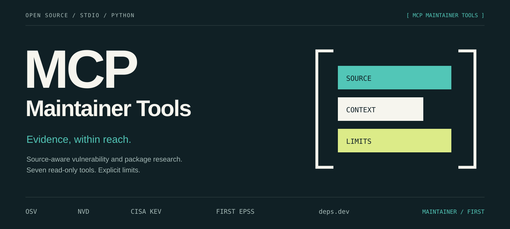

# MCP Maintainer Tools

**Evidence, within reach.** Seven read-only [Model Context Protocol](https://modelcontextprotocol.io/) tools for researching package vulnerabilities, CVE records, known exploitation, exploit probability, and package metadata.

[](https://github.com/No3214/mcp-maintainer-tools/actions/workflows/tests.yml)

[Get started](#get-started) · [Usage guide](docs/USAGE.md) · [Contribute](CONTRIBUTING.md) · [Security](SECURITY.md) · [Brand assets](docs/BRAND.md)

The server connects an MCP client to **OSV, NVD, CISA KEV, FIRST EPSS, and deps.dev** over local **stdio**. It returns source context and explicit pagination so maintainers can inspect the evidence behind an answer.

Results are available as both structured MCP objects and JSON text, with an object output schema for every tool.

This is an early public release. It supplies research inputs; release approval, remediation, and risk decisions remain with the maintainer. It does not inspect a local repository, install dependencies, or apply patches.

Existing scanners and MCP servers address overlapping workflows. The [validation plan](docs/VALIDATION.md) compares alternatives and defines a real-user pilot; external adoption and a measurable advantage have not yet been established.

## Get started

You need **Git, Python 3.11 or newer, an MCP client with stdio support, and HTTPS access to the providers**. Install from this repository; a PyPI release is not provided by this project at present.

### macOS or Linux

```sh
git clone https://github.com/No3214/mcp-maintainer-tools.git
cd mcp-maintainer-tools
python3 -m venv .venv
./.venv/bin/python -m pip install .
```

### Windows PowerShell

```powershell
git clone https://github.com/No3214/mcp-maintainer-tools.git
Set-Location mcp-maintainer-tools
py -3 -m venv .venv
.\.venv\Scripts\python.exe -m pip install .
```

Confirm that the chosen Python installation is 3.11 or newer. These commands call the environment's interpreter directly, so shell activation is unnecessary.

### Connect your MCP client

Use the absolute path to the installed environment's Python executable. For a client that uses the common `mcpServers` configuration shape:

```json
{
  "mcpServers": {
    "maintainer-tools": {
      "command": "/absolute/path/to/mcp-maintainer-tools/.venv/bin/python",
      "args": ["-m", "mcp_maintainer_tools"]
    }
  }
}
```

Replace the example path with your actual path. Windows uses `.venv\Scripts\python.exe`; escape backslashes in JSON. Ready-to-edit examples are available for [macOS/Linux](examples/mcp-config-unix.json) and [Windows](examples/mcp-config-windows.json). Configuration formats vary by client.

The installed `mcp-maintainer-tools` command is also available. The [minimal configuration](examples/mcp-config.json) works when this command is on the client's `PATH`.

**The process speaks MCP, not an interactive shell.** Your client starts it and exchanges protocol messages over stdin/stdout. Starting it directly may look idle because it is waiting for an MCP request. No HTTP listener is opened. Use `python -m mcp_maintainer_tools --help` or `--version` with the installed environment's interpreter to check the command without starting the server.

No API key is required. An optional `NVD_API_KEY` can be supplied through the server process environment or your client's secret settings. Keep the key out of repository files, example configurations, and diagnostic output.

By default, the transport ignores environment proxy and custom-CA settings. If your network requires them, explicitly set `MCP_MAINTAINER_TOOLS_TRUST_ENV=true` in the server environment and supply only trusted proxy/CA settings. TLS verification remains enabled. Restart the server after changing the setting; see [network configuration](docs/USAGE.md#network-and-credentials) for the accepted values and variables.

## Seven tools, one research workflow

| Tool | Input | What it returns |
| --- | --- | --- |
| `osv_query` | Package `name`, `version`, optional `ecosystem` and `page_token` | One page of matching advisories, identifiers, and continuation metadata. |
| `osv_batch` | Up to 100 package objects | One page of advisory identifiers per package, with independent continuation tokens. |
| `osv_vuln` | `vuln_id` | The OSV record, retaining package-specific affected ranges and references. |
| `nvd_cve` | `cve_id` | The NVD CVE record, preserving attribution for its metrics, or explicit absence. |
| `kev_check` | Up to 100 `cve_ids` | Matches against a fetched CISA KEV catalog, with catalog metadata and the actual source used. |
| `epss` | Up to 100 `cve_ids`, optional `offset` and `limit` | A page of FIRST EPSS scores and continuation metadata. |
| `depsdev_package` | Package `name`, optional `system` | Package identity and metadata for the provider-marked default version, if identified. |

OSV defaults to ecosystem `npm`; deps.dev defaults to system `npm`. Their ecosystem/system identifiers are not interchangeable. The [usage guide](docs/USAGE.md#tool-reference) describes arguments and limits.

For example, ask an MCP client:

> Look up OSV records for `lodash` version `4.17.21` in the `npm` ecosystem. Retrieve every page. For any advisory with a CVE alias, use NVD, KEV, and EPSS for additional context. Preserve sources and unknowns; do not call the package safe merely because a lookup is empty.

This demonstrates a research workflow. It is not a current assessment or recommendation of the example package version. Individual OSV records can be retrieved with `osv_vuln` after the query or batch lookup.

## Read the evidence correctly

| Result | Interpretation |
| --- | --- |
| OSV `has_more: true` | Fetch the next page using `next_page_token`, even when the current page has no records. |
| EPSS `has_more: true` | Repeat the same CVE query with `next_offset`. |
| NVD `found: false` | This lookup did not return a CVE record. It is not a clean bill of health. |
| A CVE in `not_in_kev` | It was absent from the fetched KEV catalog. Check catalog date and source; this does not establish that it has never been exploited. |
| deps.dev `default: null` | The provider did not identify a default version. The tool does not choose one for you. |
| A failed tool call | The request or response could not be used. Do not replace the failure with an empty success. |

Provider coverage and update timing differ. Upstream text and references are **untrusted data**, not instructions to an assistant or authorization to execute commands. The tools do not supply a complete inventory scan or a guarantee that software is secure.

`kev_check` tries CISA's canonical feed first. For specific availability failures, it can use CISA's [official GitHub mirror](https://github.com/cisagov/kev-data). It reports `source_url`, `canonical_source_url`, and `fallback_used` so the source remains visible. The mirror may lag the canonical feed; retrieval time alone does not establish catalog freshness. Malformed, unsafe, or inconsistent data is rejected rather than hidden by a fallback. See the [KEV source policy](docs/USAGE.md#kev-sources-and-freshness) for the exact conditions.

## Where your queries go

Calls make outbound HTTPS requests. A package name or version can reveal a dependency, including a private one. Query only information you are comfortable sending to the relevant provider.

| Provider | Data sent | Official documentation |
| --- | --- | --- |
| OSV — `api.osv.dev` | Package names, versions, ecosystems, continuation tokens, or advisory identifiers. | [OSV API](https://google.github.io/osv.dev/api/) |
| NVD — `services.nvd.nist.gov` | CVE ID and the optional API key in a request header. | [NVD vulnerability API](https://nvd.nist.gov/developers/vulnerabilities) |
| CISA KEV — `www.cisa.gov`; fallback hosted at `raw.githubusercontent.com` | Request for the full public catalog, first from CISA and, on eligible failures, from its official `cisagov/kev-data` mirror. Your CVE list is matched locally and is not sent to either host. | [KEV catalog](https://www.cisa.gov/known-exploited-vulnerabilities-catalog), [official mirror](https://github.com/cisagov/kev-data) |
| FIRST — `api.first.org` | CVE IDs and pagination parameters. | [EPSS API](https://api.first.org/epss/) |
| deps.dev — `api.deps.dev` | Package name and system; default version when identified. | [deps.dev API v3](https://docs.deps.dev/api/v3/) |

## Development and project health

From a checkout, install the development dependencies and run the tests:

```sh
./.venv/bin/python -m pip install -e '.[dev]'
./.venv/bin/python -m pytest -q
```

On Windows, use `.\.venv\Scripts\python.exe` in place of `./.venv/bin/python`. Tests use mocked provider responses, including a real MCP stdio client/server exchange; they do not require API keys. See [CONTRIBUTING.md](CONTRIBUTING.md) for change and testing guidance, and the [CI workflow](.github/workflows/tests.yml) for the current validation matrix.

CI is configured for Python **3.11–3.14 on Ubuntu**, plus **Python 3.12 on Windows and macOS**. Additional jobs check lint and formatting, Bandit security patterns, build and Twine package validation, CLI/stdio behavior using the built wheel, and known vulnerabilities in the resolved runtime dependencies. The workflow badge links to actual run results; configuration alone does not establish that a revision passed.

The `Required checks` job succeeds only when every prerequisite job succeeds. Job logs record the tested interpreter, resolved dependencies, commit, and package origin; package verification also records archive digests. See the [0.1.4 interoperability audit](docs/AUDIT-0.1.4-2026-10-22.md) for the current change and measured results, the [0.1.3 protocol logging audit](docs/AUDIT-0.1.3-2026-10-22.md) for logging boundaries, and the [0.1.2 dispatch audit](docs/AUDIT-0.1.2-2026-10-22.md) for concurrency and verified repository protection.

The `dev`, `audit`, and `build` extras provide the corresponding local tools. The [contribution guide](CONTRIBUTING.md#run-the-quality-and-package-checks) lists the commands. The MCP SDK is constrained to the **1.30 series** while its typed-input, protocol-version, and log/error adapters are reviewed against that series.

Report implementation vulnerabilities through [SECURITY.md](SECURITY.md). Use [GitHub issues](https://github.com/No3214/mcp-maintainer-tools/issues) for reproducible bugs, documentation improvements, and proposed changes to scope.

## License and identity

Project code and original brand assets are available under the [MIT License](LICENSE). Data returned by external services may have separate attribution and use terms. Provider names identify integrations and do not imply affiliation or endorsement.

The [brand guide](docs/BRAND.md) contains editable SVG assets, colors, typography, and claim boundaries for project communications.
